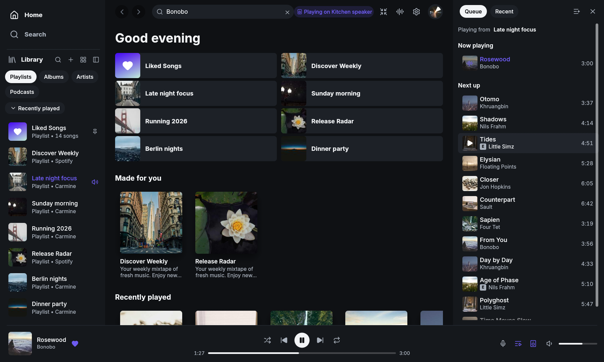
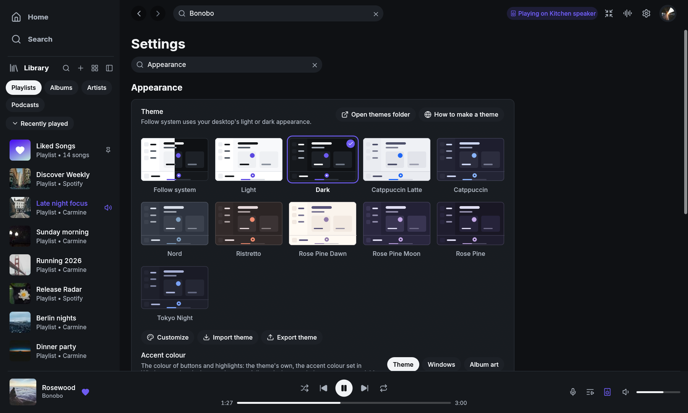

<p align="center">
  
</p>

<h1 align="center">LWSpot</h1>

<p align="center"><strong>A lightweight native Spotify client for Windows.</strong></p>

<p align="center">
  <a href="https://github.com/BJDevelopes/lwspot/releases"><strong>Download</strong></a> ·
  <a href="docs/_guide/getting-started.md">Getting started</a> ·
  <a href="docs/_guide/using-lwspot.md">User guide</a> ·
  <a href="CONTRIBUTING.md">Contribute</a>
</p>

<p align="center">
  <a href="Cargo.toml"></a>
  <a href="https://github.com/BJDevelopes/lwspot/releases"></a>
  <a href="LICENSE"></a>
</p>

LWSpot is a Spotify client for Windows, written in Rust with
[egui](https://github.com/emilk/egui). It plays music through
[librespot](https://github.com/librespot-org/librespot) and has no browser
engine, so it runs as one small process. It is a Windows-only fork of
[Spotifast](https://github.com/crmne/spotifast).

The interface is available in English and 15 other languages.

**Playback needs Spotify Premium.** Free accounts can browse and search, but
cannot play music through LWSpot.



## Features

| Feature | What you can do |
|---|---|
| **Library and search** | Browse playlists, Liked Songs, albums, artists, and podcasts. Search the catalogue and edit playlists you own. |
| **Spotify Connect** | Play on this computer, or control playback on your other devices. |
| **Themes** | Pick a theme from a gallery of live previews, or make your own in the theme editor (it warns when text gets hard to read) and share it as a file. Take the accent colour from the theme, from Windows, or from the playing song's cover. Mica or acrylic backdrop on Windows 11. |
| **Windows integration** | Media keys and the Windows media overlay (also on the lock screen), Previous/Play/Next buttons in the taskbar preview, and jump list tasks on the taskbar's right-click menu. Keep music playing from the tray, start with Windows (optionally in the tray), F11 for full screen, and a title bar in the theme's colours. |
| **Winamp mini player** | Use classic `.wsz` skins with an equalizer, playlist, and animated sound displays. Switch with **Ctrl+M**. |
| **Lyrics** | Follow synced lyrics in a side panel or full screen. |
| **Equalizer** | Shape local playback with a ten-band equalizer, preamp, and balance. |
| **Visualizer** | A spectrum or waveform behind the player bar, at 20, 30, or 60 frames a second. It stops while the window is covered or minimized. |
| **MilkDrop** (optional) | Watch music-reactive visuals in a separate window or full screen, with more than 10,000 presets. It is an add-on of a few MB, downloaded the first time you turn it on. |
| **Reliable playback** | Sign-in survives restarts (Windows Credential Manager, with an encrypted fallback), audio follows your default output when you plug in headphones or connect Bluetooth, and audio errors say what went wrong in plain words. |
| **Install your way** | An installer that needs no administrator rights, or a portable ZIP that keeps its settings, caches and logs in its own `data` folder. Both update themselves. |



## How light is it?

Measured on one laptop (an MSI GF65 with Windows 11), in one
session, with release builds playing the same song and 60-second averages.
LWSpot had the player bar spectrum visualizer on at 30 frames a second.

| While playing | Official Spotify app | LWSpot 0.1.0 |
|---|---|---|
| Memory (working set) | 1,297 MB across 8 processes | 148 MB, 1 process |
| Private memory | 927 MB | 73 MB |
| CPU, window visible | 22% of one core | 18.4% of one core |
| CPU, window minimized | 2.1% of one core | 1.3% of one core |
| CPU, window covered by other windows | not measured | about 0.6% of one core |

Your numbers will vary with your hardware, library, and settings. With the
visualizer off, LWSpot redraws only when something on screen changes. The
[roadmap](ROADMAP.md#phase-2-lighter) has the full measurements.

## Install

Download the latest release from
[GitHub Releases](https://github.com/BJDevelopes/lwspot/releases):

| File | Use it for |
|---|---|
| `lwspot-vX.Y.Z-x86_64-pc-windows-msvc-setup.exe` | Installer for most PCs (Intel and AMD). Installs for your user only; no administrator rights needed. |
| `lwspot-vX.Y.Z-x86_64-pc-windows-msvc.zip` | Portable copy for most PCs. Extract and run `lwspot.exe`; it keeps its settings and caches in the `data` folder beside it. |
| `lwspot-vX.Y.Z-aarch64-pc-windows-msvc-setup.exe` / `.zip` | The same, for Windows on ARM. |
| `checksums.txt` | SHA-256 checksums for every download. |

The installer is not code-signed yet, so SmartScreen may warn about an unknown
publisher. Choose **More info**, then **Run anyway**. Check a download against
`checksums.txt` with `Get-FileHash <file> -Algorithm SHA256`. A winget package
is planned. [Download](docs/_guide/download.md) has the details, including
how the portable copy keeps its data. To build it yourself, see
[Build from source](docs/_guide/getting-started.md#build-from-source).

## Start listening

1. Open LWSpot and choose **Sign in with Spotify**. Approve access in your
   browser, then return to the app to see your library.
2. To listen on this computer, open the device menu in the bottom player bar
   and choose **Set up playback here**, also available in Settings.
3. Complete the separate playback approval in your browser. Your computer
   appears as a Spotify Connect device named **LWSpot**.

Library access and local playback have separate approvals. LWSpot remembers
both in Windows Credential Manager, or in a file encrypted for your Windows
user when Credential Manager cannot keep them. See
[Getting started](docs/_guide/getting-started.md) for the full walkthrough
and [How it connects](docs/_reference/how-it-connects.md) for the details.

## Guides and help

| You want to… | Read |
|---|---|
| Find out what LWSpot does and does not do | [What is LWSpot?](docs/_guide/what-is-lwspot.md) |
| Install it and check a download | [Download](docs/_guide/download.md) |
| Sign in, set up playback, or configure themes and proxies | [Getting started](docs/_guide/getting-started.md) |
| Learn shortcuts, the taskbar and tray, start with Windows, command-line controls, and updates | [Everyday use](docs/_guide/using-lwspot.md) |
| Use the Winamp mini player or MilkDrop | [Winamp mini player](docs/_guide/winamp.md) · [MilkDrop](docs/_guide/milkdrop.md) |
| Reduce loading delays | [Make it even faster](docs/_guide/make-it-even-faster.md) |
| Find configuration and stored files | [Settings and files](docs/_reference/settings-and-files.md) |
| Understand what is stored and sent | [Privacy](docs/_reference/privacy.md) · [How it connects](docs/_reference/how-it-connects.md) |
| Check Spotify and librespot limitations | [What Spotify allows](docs/_reference/what-spotify-allows.md) |
| Understand account risk | [Will my account get banned?](docs/_guide/what-is-lwspot.md#will-my-spotify-account-get-banned) |
| Report a bug or propose a feature | Read [Contributing](CONTRIBUTING.md), then open an [issue](https://github.com/BJDevelopes/lwspot/issues/new/choose). |

## Contributing

Read [CONTRIBUTING.md](CONTRIBUTING.md) before opening an issue or pull
request. To look at the interface without a Spotify account, run:

```powershell
cargo run --features demo -- --demo
```

The [roadmap](ROADMAP.md) lists what is done and what is next, and the
[changelog](CHANGELOG.md) what changed in each release.

Translations live in `assets/i18n/`; see
[Translating LWSpot](docs/_reference/translating.md). Release packaging
is described in [PACKAGING.md](PACKAGING.md).

## Acknowledgements

LWSpot is a fork of [Spotifast](https://github.com/crmne/spotifast) by
[Carmine Paolino](https://github.com/crmne), released under the MIT License.
LWSpot builds on that work and narrows it to Windows.

LWSpot uses [librespot](https://github.com/librespot-org/librespot),
[egui](https://github.com/emilk/egui), the [Inter](https://rsms.me/inter/)
typeface (OFL), and [Lucide](https://lucide.dev) icons (ISC).

LWSpot is an independent project and is not affiliated with Spotify.
Spotify is a trademark of Spotify AB.

Licensed under the [MIT License](LICENSE).
