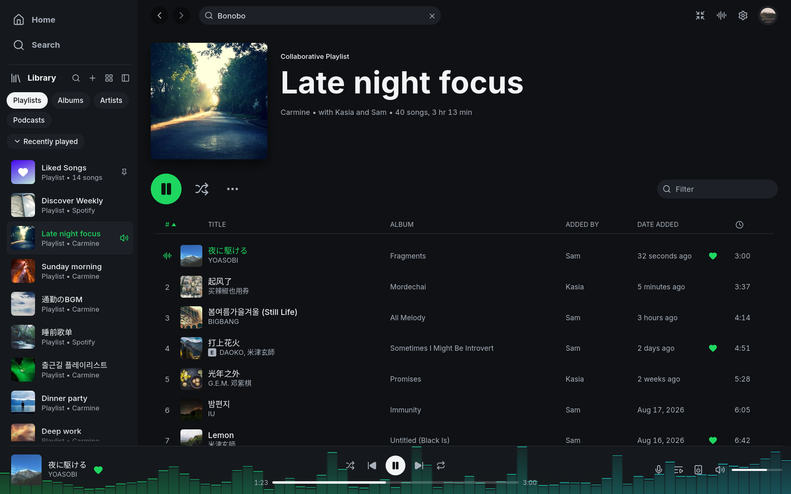

## Install

Follow the steps on the [Download page](download.md). Then open **LWSpot**
from the Start menu, or open `lwspot.exe` from the folder where you extracted
the ZIP.

## Sign in

Press **Sign in with Spotify**. Your browser opens Spotify's sign-in page.
Approve access there, then return to LWSpot to see your library.
LWSpot never sees your Spotify password.

LWSpot remembers your sign-in in Windows Credential Manager, so you normally
do not need to sign in each time you open the app.

## Enable playback on this computer

**Playing music requires Spotify Premium.** To listen on this computer,
open the device menu in the bottom player bar and select **Set up playback
here**, or find the same option in Settings.

Spotify asks you to approve playback separately from library access. Follow
the browser prompt once; LWSpot remembers this approval too.
[Read more about the two sign-ins](../_reference/how-it-connects.md).

The computer then appears as a Spotify Connect device named **LWSpot**.
You can rename it in Settings.

## Basics

- **Closing the window does not stop the music.** LWSpot keeps playing
  from the system tray; reopen it from the tray icon and quit from the tray
  menu or Ctrl+Q. Settings can turn this off.
- **Play and Pause fade.** With the default audio settings, music played on
  this computer fades in or out to avoid a hard cut.
- **Play buttons show progress.** The button spins until Spotify responds.
- **Artist names are links.** Click a credited artist in the player bar to
  open their page, even while the rest of the song's details are loading.
- **Common actions have shortcuts.** Space plays and pauses, Ctrl+F or `/`
  searches, and `Q` opens the queue. Ctrl+/ shows the full list.
- **Right-click for more actions.** Right-click a song, playlist, album,
  artist, or podcast to see its menu. These menus are available in Home,
  Search, Library, and artist pages. Your own playlists include **Edit details**
  and **Delete**. Opening a menu does not start playback.
  In **Add to playlist**, type a playlist name to find it, or choose
  **New playlist**. Typing chooses the first match, so `Enter` adds to it;
  the up and down arrows choose another. You can add one song or a selection.
  If the playlist already contains the song, LWSpot asks before adding
  another copy.
- **Spotify links open in LWSpot.** A `spotify:` link shared from another
  app opens its page, starting LWSpot if it is not running. Links to
  `open.spotify.com` go through the browser first, which hands them over the
  same way. `lwspot <link>` does the same from a terminal.

## Match your Windows theme

Open **Settings → Appearance → Theme** and choose **Light**, **Dark**, or
**Follow system**. Follow system matches the light or dark mode set in
Windows. New installations use Follow system.

For your own colours, see [custom themes](../_reference/settings-and-files.md#custom-themes).

## If song titles show empty boxes

LWSpot uses your computer's fonts to display titles in different languages.
Windows already includes fonts for most languages.

Titles can mix languages, including those written from right to left.
Long titles are shortened with dots to fit the available space.



## Choosing the interface language

LWSpot uses your computer's language when it has a translation for it, and
English otherwise. To pick another language, open **Settings → Appearance →
Language**. Each language is listed under its own name, and the change applies
at once. Choose **System** to follow the computer again. Spanish, Turkish and
Ukrainian are complete; other translations are in progress, and anything not yet
translated appears in English. See [Translating LWSpot](../_reference/translating.md) to help.

## Choosing which app opens Spotify links

Choose the app in **Settings → Apps → Default apps** in Windows.

## If your network needs a proxy

You can configure a proxy, a server your network uses to reach the internet,
on the sign-in screen or in **Settings → Proxy**. Enter the address, port, and
any login details supplied by your network administrator. LWSpot protects
the saved proxy password. If it cannot save the password, it tells you and
uses it only until you quit.

Playing music on this computer supports only HTTP proxies without a login.
With other proxy types, music connects directly to Spotify even though
browsing uses the proxy. Your browser has separate proxy settings, which may
also need configuring for sign-in.
See [proxy options and limits](../_reference/how-it-connects.md#proxy).

## Build from source

You need:

- Rust with the MSVC toolchain. `rust-toolchain.toml` pins the exact
  version, and [rustup](https://rustup.rs) installs it automatically.
- Visual Studio 2022 (or its Build Tools) with the C++ build tools.

To build without MilkDrop, which needs nothing else:

```powershell
cargo build --release --no-default-features
```

The default build includes MilkDrop. It builds libprojectM from source, so it
also needs CMake, libclang (from LLVM), and vcpkg with GLEW installed.
Set `VCPKG_INSTALLATION_ROOT` to the vcpkg folder, then build:

```powershell
vcpkg install glew:x64-windows-static
cargo build --release
```

The app is written to `target\release\lwspot.exe`.

To look at the interface without a Spotify account, run the demo:

```powershell
cargo run --features demo -- --demo
```
