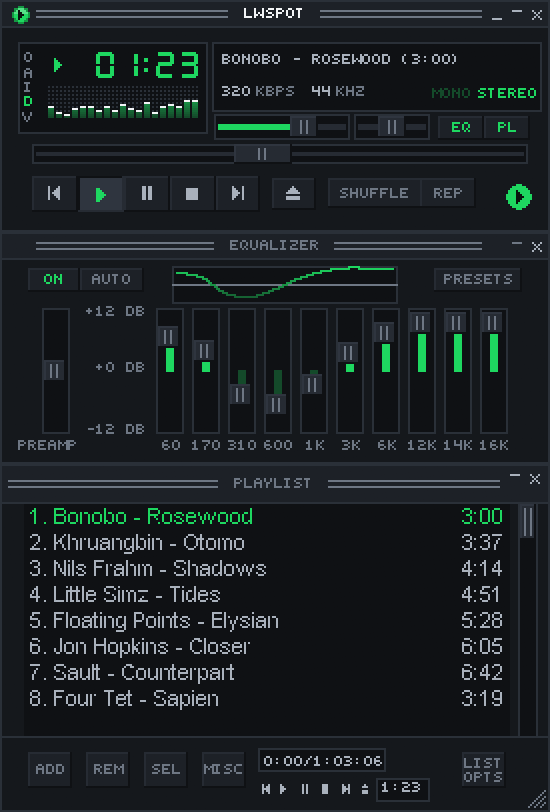

## How light is it?

  
<strong>4x</strong>less CPU than Spotify's app

  
<strong>10x</strong>less memory than Spotify's app

  
<strong>1</strong>process, no browser engine

  
<strong>0.13 s</strong>from launch to window

While playing with the window open, measured on one Windows laptop.
Your numbers will vary. <a href="what-is-lwspot/#how-light-is-it">See the measurements</a>.

## It turns into Winamp

Load a classic `.wsz` skin from the
[Winamp Skin Museum](https://skins.webamp.org). The mini player includes
animated sound displays, an equalizer to adjust your sound, and a playlist.
Roll it up into a thin bar or enlarge it while keeping the classic pixels
sharp. [See the mini player in detail](_guide/winamp.md).

  

## MilkDrop with more than 10,000 presets

MilkDrop is a small add-on LWSpot downloads the first time you turn it on,
along with the original MilkDrop 2 presets and projectM's Cream of the Crop
collection. These visual designs
react to music playing on your computer, in a resizable window or full screen.
[See the controls and preset details](_guide/milkdrop.md).

<video class="milkdrop-showcase" autoplay loop muted playsinline preload="metadata" poster="assets/images/milkdrop-poster.jpg" aria-label="MilkDrop presets reacting to music in LWSpot">
  <source src="assets/images/milkdrop.mp4" type="video/mp4">
</video>

## Support LWSpot

  
LWSpot is free and open source, with no ads and no tracking. If it has
  earned a place on your desktop, you can support its development.

  <a class="lw-coffee" href="https://buymeacoffee.com/bjdevelopes" target="_blank" rel="noreferrer">☕ Buy me a coffee</a>

## Credits

LWSpot is a fork of
[Spotifast](https://github.com/crmne/spotifast) by Carmine Paolino. It is an
independent project, not affiliated with or endorsed by Spotify AB. Spotify
is a trademark of Spotify AB.
